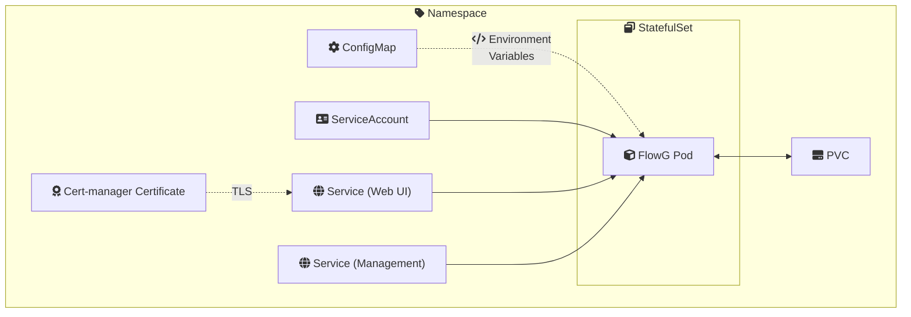
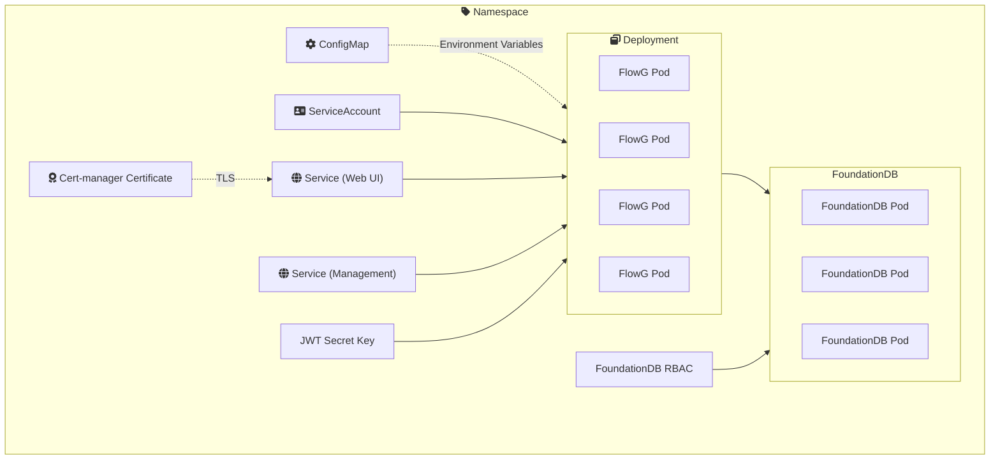
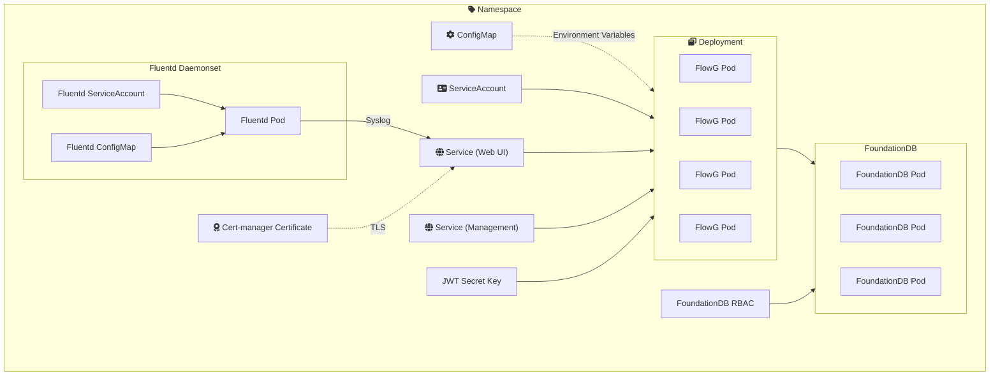

import Tabs from '@theme/Tabs';
import TabItem from '@theme/TabItem';

Alongside the recent release of [0.64.0](https://github.com/link-society/flowg/releases/tag/0.64.0), we are happy to introduce you to 3 Helm Charts to enable you to deploy FlowG faster and smoother in your own cluster.

<!-- truncate -->

## First of all, why Kubernetes?

Since [0.61.0](https://github.com/link-society/flowg/releases/tag/0.61.0) FlowG can run in a cluster using FoundationDB as a backend (instead of BadgerDB). But up until now, clusterizing it was a bit complicated:
- A bare-metal cluster relies on complex, hard to automate and maintain mechanisms (Pacemaker, Corosync, Keepalived). And orchestrating VMs on the global level quickly becomes a mess when you add Ansible/Chef in the equation and start thinking about global resources and processes management.
- The Docker compose approach is limited to a single-host environment. Service dependencies are still lacking — especially with FoundationDB, which is as lazy as my roommate. Compose also struggles to handle environment variables, volumes and secrets replication, and updating images inevitably causes downtime.

That is why we came up with the idea of offering an easy way to do so using Kubernetes. Since FlowG has always been available as a Docker image, it was possible even before, but writing — on your own, which implies knowing FlowG — and maintaining manifests in a multi-stage environment is still... tedious. 

## Charting the cluster 

To provide a universal solution, so you don't have to struggle with your own manifests, we came up with Helm Charts.

First of all, why Helm? 
Helm aims to be the "package manager for Kubernetes" we theoretically all need. They provide a solution to a problem every Ops Engineer has ever asked: "how the hell can I update this service and its dependencies without breaking anything and without spending a month?". They bring up a really neat package-level approach: every service is now managed as a "release" you can add, remove, replace and update independently. This has the highly satisfying result of saving engineers from wrestling with namespaces and individual resources. You just need to list what's installed on your cluster and manage it with 3 or 4 configuration files (`values.yaml`) for the whole cluster.

However, Helm isn't a magic wand. From an operator perspective, running complex distributed systems through Helm often reveals its own set of challenges: 

- A single typo in a `values.yaml` file can lead to invalid manifests or silent misconfigurations if parameters aren't strictly validated. Everything works on the node, except for no apparent reason, Prometheus doesn't scrape, the wrong Docker image is pulled, or worse, the PVC is never mounted. All this because you wrote `podAnotations` instead of `podAnnotations`, you know? 
- Helm can sometimes behave weirdly in case a deployment fails mid-way, getting stuck in a `pending-upgrade` state, leaving you to clean the cat's litter box on your own as it watches you with a mocking expression.
- Stateful workload migrations are... complicated. Running `helm upgrade` on stateless microservices is easy; doing it on a distributed storage engine like FoundationDB requires strict lifecycle hooks and ordering to avoid data locks or downtime. 

So, why did we choose Helm? Because despite all its flaws, it remains a great solution to easily distribute mid-size services on Kubernetes. Since FlowG is almost never a primary application within a cluster, it is much simpler from a user perspective to have it automatically managed by a program and a simple and understandable configuration file — instead of a complex CRD or a fixed manifest that are heavy and can cause manual interventions and/or downtime.

## What does it look like? 

As I said earlier, there are 3 different charts, each providing a different architecture based on your needs. 

<Tabs defaultValue="singlenode">

<TabItem value="singlenode" label="Single-node">
This one provides a **single-node** approach, with only 1 FlowG process, attached to a persisten volume *(PVC)*, which relies on [BadgerDB](https://github.com/dgraph-io/badger) as a back-end.



This one is perfect for small clusters (homelabs, for example) or environments with a low SLA. 

</TabItem>

<TabItem value="multinode" label="Multi-node">
Another allows for a **multi-node** setup, this time using [FoundationDB](https://www.foundationdb.org/). Though letting you manage the FoundationDB CRDs setup, it comes with its own FoundationDBCluster, which can be configured according to your needs (redundancy modes, processes counts, etc.). 



</TabItem>

<TabItem value="observability" label="Multi-node + Fluentd">
The last one follows the same principle as the previous one, while bringing up an additional [Fluentd](http://fluentd.org/) **observability stack** to help you route your cluster's services logs directly into FlowG. 



</TabItem>

</Tabs>

---

> To learn how to quickly run FlowG on your Kubernetes cluster, just follow [this guide](/docs/user/advanced/k8s/setup.md).

### Showtime! 

Theory's fine, now let's move on to a bit of practice. In fact, deploying a FlowG instance on your cluster is really simple.

[](https://asciinema.org/a/DEWSNyEPQUs1VfzV) *A quick example showing the deployment of a single-node FlowG instance*

Here's how fast it goes: 

```bash
# Grab the repository
git clone https://github.com/link-society/flowg
cd flowg/k8s/charts

# Install the chart
helm upgrade --install flowg flowg-singlenode --namespace flowg --create-namespace
```

Curious on how it can expand to complex shenanigans with more complex architectures?

**Installing multi-node + Fluentd version**: 
```bash
# Install FoundationDB CRDs
git clone https://github.com/foundationdb/fdb-kubernetes-operator fdb
cd fdb/charts/fdb-operator

helm upgrade --install fdb . --namespace flowg --create-namespace

# Install the actual FlowG chart
cd ../../..
git clone https://github.com/link-society/flowg
helm upgrade --install flowg flowg/k8s/charts/flowg-observability --namespace flowg
```

And that's it for the installation. Changing configuration? You can read our [documentation reference](/docs/technical/helm_reference.md). We also provide tutorials to help you setup key features, like [TLS encryption](/docs/user/advanced/k8s/https.md).

## Now, why Fluentd?

Yes, that's a legitimate question, and an architectural choice we'll need to motivate. 

In Kubernetes (and Docker in fact), most applications spew their logs to stdout/stderr. FlowG being mostly a Syslog server (that's the main way to send logs to it), it cannot guess or "pull" logs from other pods without an agent that would do so.  
That's why **Fluentd** is there: to collect logs (usually stored in `/var/log/containers`) and send them to FlowG.

In the Multi-node + Fluentd chart, we use the [Fluentd Kubernetes Daemonset](https://github.com/fluent/fluentd-kubernetes-daemonset). 

First of all, why a `DaemonSet` precisely? A `DaemonSet` runs exactly one pod per node (physical machine). Every Fluentd instance reads, with advanced permissions, all the logs on the node, and sends them to FlowG.  
A sidecar (a container that executes on every pod that would be tracked) could also be considered, but it is way too complex to deploy in a Helm Chart context, and consumes too many resources (basically, it just doubles the number of processes that are executed by the nodes). A DaemonSet is easy to set up by a Chart (just one manifest file, in addition to its RBAC setup), and costs almost nothing. 

Now, why **Fluentd** precisely?  
First, because it is stable, mature and well documented (CNCF Graduated). It means API, configuration format and execution standards won't break over time, which means almost no dependency management or maintenance for the Fluentd-side of the chart. And also, it has solid support for the Syslog protocol, which is essential when sending logs to Flowg.

### An important word about our collection philosophy

As a user, you'll probably see that almost no Fluentd configuration options are left to you. That's totally normal. We in fact started from the premise that FlowG already allows you to filter, select, and process logs. We only want Fluentd in a log-routing context. So in fact, its configuration is pretty simple: 

1. Parse logs from user-configured `logdir`, excluding all references to fluentd (to avoid loops and crashes). 
2. Apply a CRI filter to correctly parse date, time, and separate information.
3. Send it to FlowG directly over syslog protocol. 

<details>
<summary>**Configuration details**</summary>

```
<source>
      @type tail
      path {{ .Values.fluentd.logdir }}/**/*
      exclude_path ["{{ .Values.fluentd.logdir }}/*fluentd*", "{{ .Values.fluentd.logdir }}/*fluentd*/*",  "{{ .Values.fluentd.logdir }}/*/*fluentd*/*", "{{ .Values.fluentd.logdir }}/*fluentd*/*/*" ]
      pos_file /var/log/fluent/log.pos
      tag logs

      <parse>
        @type cri
      </parse>
    </source>

    <match logs>
      @type copy
      <store>
        @type stdout
      </store>
      <store>
        @type remote_syslog
        host {{ include "flowg.fullname" . }}.{{ .Release.Namespace }}.svc.cluster.local
        port {{ .Values.flowg.syslog.port  }}
        severity debug
        program fluentd
        hostname ${tag[1]}

        <buffer tag>
        </buffer>

        <format>
          @type json
        </format>
      </store>
    </match>
``` 

</details>

