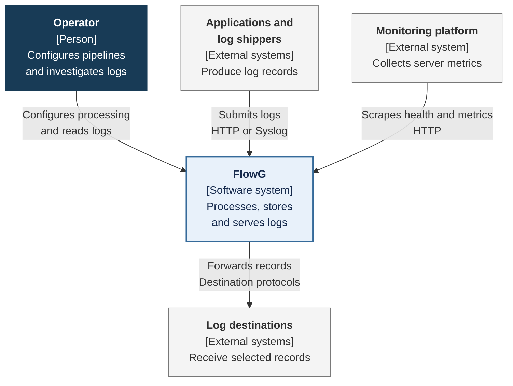
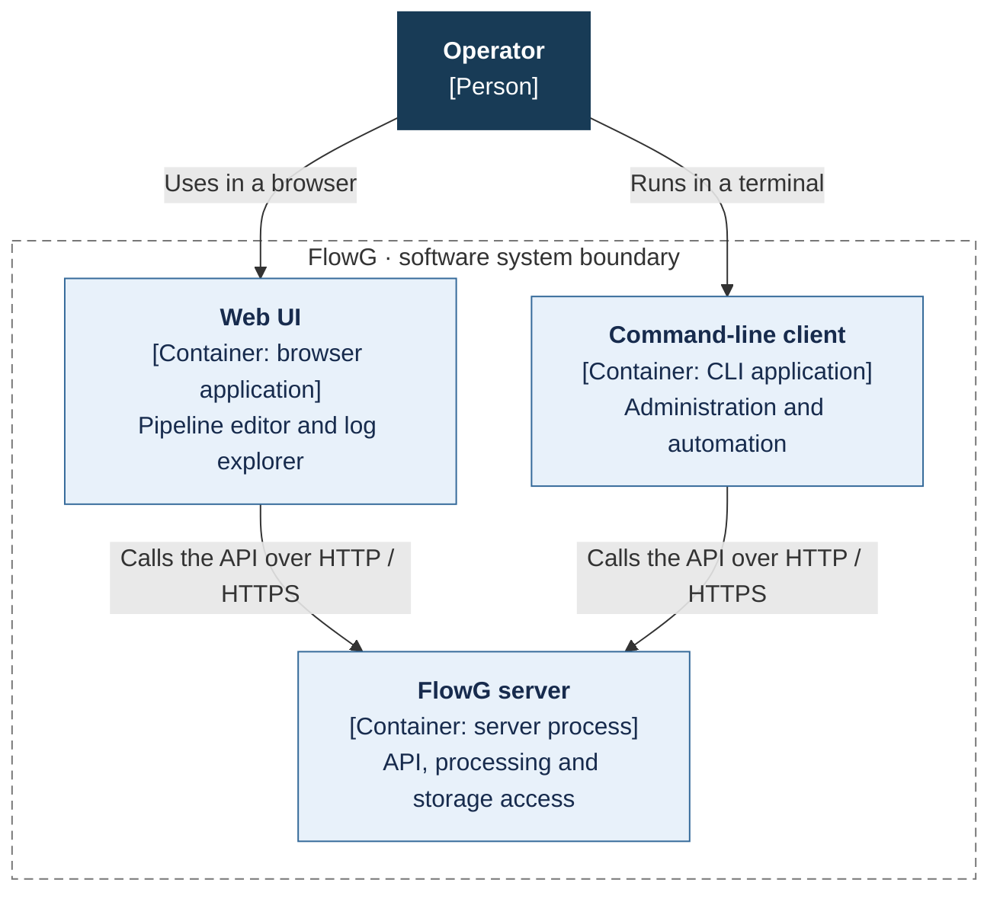
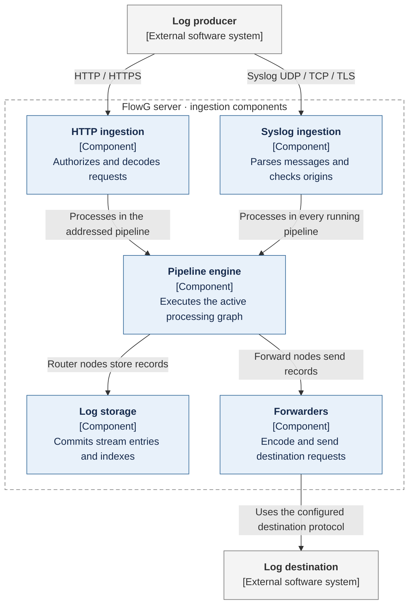
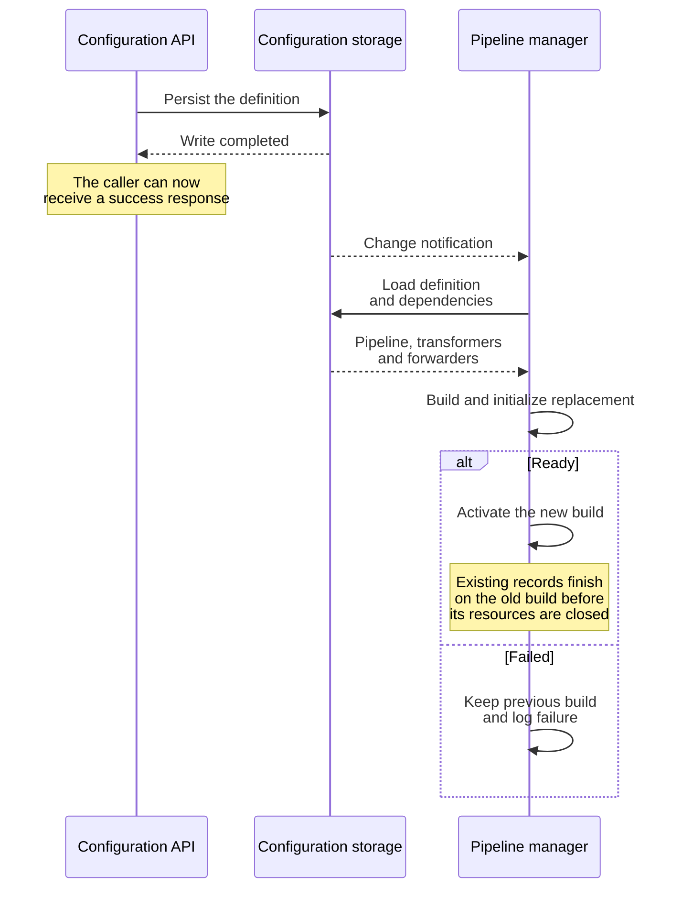
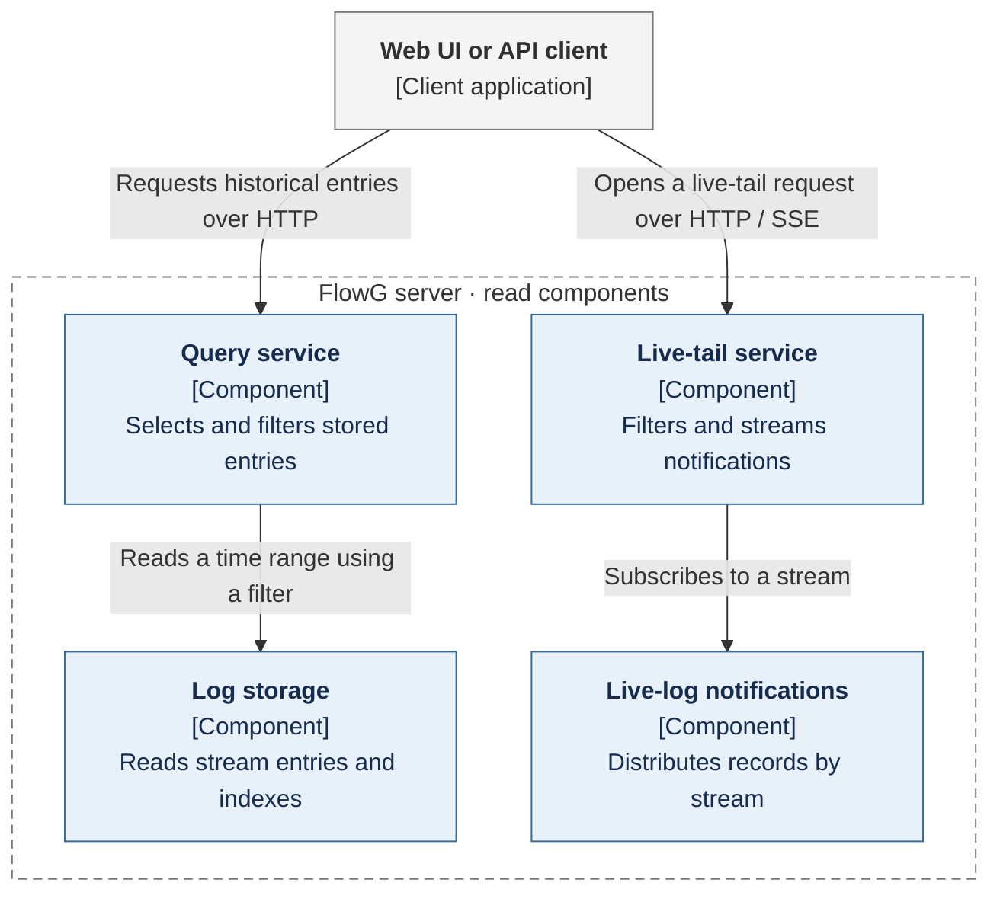
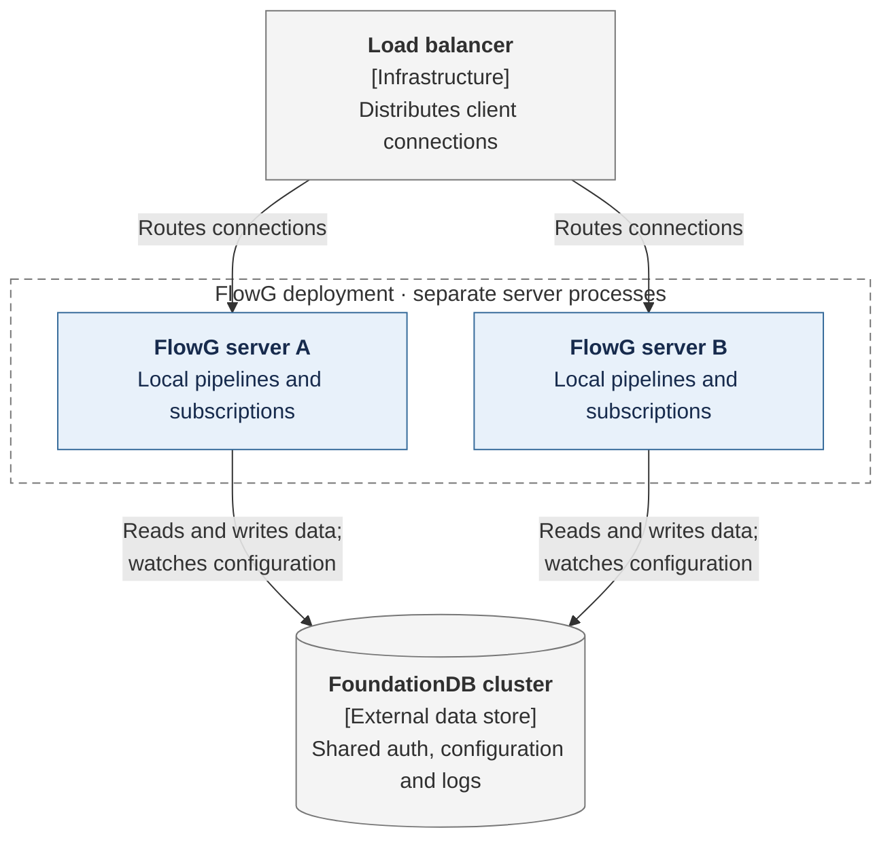

# Architecture

FlowG separates **how logs are processed** from **where logs are retained**. A pipeline describes processing: transforming records, selecting branches, invoking another pipeline, storing records or forwarding them. A stream describes retained data: its entries, indexes and retention policy. Receiving a log does not automatically store it; the pipeline must route it to a stream.

## System context

FlowG sits between systems that produce logs and the people and systems that use them. Operators configure processing rules and inspect stored records. Producers submit logs without needing to know which streams or destinations the pipeline will select.

**Scope: FlowG as a whole.** The destinations and monitoring platform are independent systems. They are not required to query locally stored logs. Forwarding is selected by pipeline configuration; monitoring observes the server rather than participating in record processing.

The HTTP interface accepts FlowG's structured and text formats, OpenTelemetry log exports and supported Elasticsearch-compatible requests. The Syslog interface accepts RFC 3164 and RFC 5424 messages over UDP or TCP, with optional TLS for TCP. These are different entry points into the same processing engine, not separate log stores.

## Applications and runtime boundaries

FlowG's Web UI runs in the operator's browser. The server distributes its assets and provides the API used by both the UI and the command-line client. Neither client accesses storage directly or executes production pipelines.

**Scope: the operator-facing applications.** Log producers also call the server directly, as shown in the system context. Storage placement depends on the deployment: BadgerDB is embedded in the server and uses local directories; FoundationDB runs as a separate database cluster. The [deployment view](#deployment-and-shared-state) describes that choice.

The server exposes three independently configurable network interfaces:

| Interface | Default port | Responsibility |
| --- | --- | --- |
| HTTP | `5080/tcp` | Web UI, administration, ingestion, queries and live tail. |
| Syslog | `5514/udp` or `5514/tcp` | Syslog ingestion. The configured protocol selects the listener. |
| Management | `9113/tcp` | Health checks and Prometheus metrics, exposed separately from the user-facing API. |

## Server components

The server has three principal responsibilities: execute records using the active pipelines, manage the configuration from which those pipelines are built, and serve retained or live records. The following views separate those responsibilities so that a configuration notification is not confused with a log record or a database query.

### Ingestion and pipeline execution

HTTP ingestion addresses a named pipeline and its `direct` source. Syslog ingestion instead submits each accepted message to the `syslog` source of every running pipeline. Both delegate processing to the pipeline engine.

**Scope: record processing inside one server.** Storage and forwarding are independent outputs selected by the pipeline graph. A pipeline can store a record, forward it, do both, or discard it. The diagram does not imply that every record takes both output paths.

The ingestion components establish the record's processing context. HTTP ingestion resolves the caller and checks the permission to send logs. Syslog uses its allowed-origin configuration and, when enabled, TLS client authentication rather than API tokens. After decoding, record fields are represented as a flat map of strings with a record timestamp.

The pipeline engine separates **pipeline lifecycle** from **record execution**. It keeps initialized pipeline builds in memory and uses a configurable worker pool to execute records against them. Records do not reload pipeline definitions from storage during normal execution. Lifecycle changes replace those builds without closing resources still in use by existing records.

Within a pipeline, node connections determine execution:

| Node responsibility | Effect on a record |
| --- | --- |
| Source | Selects the entry point: `direct` or `syslog`. |
| Transform | Applies a VRL script and can produce zero, one or several output records. |
| Switch | Evaluates a condition before passing the record to successors. |
| Pipeline | Invokes another pipeline through its `direct` source. |
| Router | Stores the record in a stream, then publishes a live-log notification. |
| Forward | Calls the configured destination through a forwarder. |
| Metric | Updates a pipeline-specific counter. |

When a node has multiple successors, those branches run concurrently and execution waits for them all. A failed branch does not roll back a successful branch. For example, a record may already be committed to a stream when forwarding fails. **A pipeline execution is not a transaction spanning storage and external systems.**

HTTP ingestion waits for processing and reports failures to the caller. A retry can therefore repeat effects that already succeeded. Syslog has no application-level processing acknowledgement: TCP provides transport flow control, but it does not confirm that a record was stored or forwarded. A forwarder's successful return likewise has the meaning provided by its destination protocol, not a universal guarantee of durable delivery.

### Configuration and pipeline lifecycle

Pipeline definitions, transformer scripts and forwarder settings are persistent configuration. The running pipeline builds are derived, per-server state. This distinction allows operators to save configuration without restarting the server, but it also means that **saving a definition and activating it are separate operations**.

The configuration service persists changes. A local configuration notification bus informs the pipeline manager, which reloads definitions and initializes replacement builds. Notifications trigger reconciliation with stored state; they are not the authoritative copy of the configuration.

**Scope: the lifecycle of a configuration update.** Notification delivery is asynchronous relative to the API response. With BadgerDB, configuration writes publish local notifications. With FoundationDB, each server's database watcher detects changes and publishes notifications locally, including changes made by another server. The diagram shows the resulting interaction, not a network broadcast between FlowG servers.

A pipeline update rebuilds that pipeline; transformer or forwarder changes rebuild all pipelines. If a replacement cannot be initialized, the last working build remains active. A new pipeline with no working build remains unavailable. At startup, a broken pipeline is logged without preventing the other pipelines and the administration API from starting.

In a cluster, each server observes and applies changes independently. There is no simultaneous cluster-wide activation point. During an update, requests served by different nodes can temporarily use different pipeline versions.

### Queries and live tail

Stored queries and live tail answer different questions. A query reads persisted entries over a time range. Live tail subscribes to notifications generated as records are stored by the connected server; it is not a repeated database query.

**Scope: the two read paths.** Both require permission to read the requested stream. Queries select entries by time range, narrow them using any requested field-index values, and evaluate the optional filter on the remaining records. Retention and indexing belong to the stream, independently of the pipelines that write to it.

After a Router node's storage operation succeeds, it publishes the record to the live-log notifier. Each live-tail request subscribes to a stream and forwards matching notifications to its client. Disconnecting ends the subscription. Notifications are in memory, are not a durable replay log, and are not replicated between FlowG servers. In a multi-node deployment, historical queries see the shared storage, while live tail sees only notifications from the node handling that connection.

### Storage and access control

Storage is divided into three logical domains. These are ownership boundaries, not three separate network services.

| Domain | Owns | Used by |
| --- | --- | --- |
| Auth | Users, roles, personal access tokens and authentication-provider configuration. | Login, request authentication, authorization and access administration. |
| Config | Pipeline definitions, transformers, forwarders and system configuration. | Configuration API, pipeline lifecycle and Syslog origin checks. |
| Logs | Stream settings, entries, field catalogs and indexes. | Router nodes, historical queries, stream administration and retention. |

Log storage groups pending writes into transactions. A Router node waits for the result of its own write; its entry and associated index updates are committed together. Batching reduces transaction overhead without changing that completion boundary. It does not make an entire ingestion request or a multi-branch pipeline atomic.

Stream retention limits the age and/or size of retained data. Expiration handles age-based retention, while background collection removes older entries when a stream exceeds its size policy. These operations are independent of pipeline execution, so retention can remove stored records without changing the pipeline that produced them. The [storage specification](./storage.md) describes the data layout, indexes and backend behavior.

Access control is enforced at the API boundary using users and roles from auth storage. The UI and CLI do not provide an alternative authorization path. Native API clients use session or personal access tokens; the Elasticsearch-compatible interface supports HTTP Basic credentials. Syslog has a separate trust boundary based on allowed origins and optional client certificates. The [authentication specification](./auth.md) describes credentials and permissions.

The management interface is separate from the API so that health checks and Prometheus scraping can be exposed independently. It reports server activity; it does not participate in pipeline execution or store user logs.

## Deployment and shared state

### Single server with BadgerDB

The default deployment embeds BadgerDB in the FlowG server. Auth, configuration and logs use separate databases on local storage. A persistent volume preserves them across process or container restarts. Multiple FlowG servers must not open the same BadgerDB directories as a shared database.

This deployment keeps processing and persistence on one host. Its throughput and memory requirements include both pipeline execution and database work. The [tuning guide](/docs/technical/tuning) covers resource sizing and worker counts.

### Multiple servers with FoundationDB

FoundationDB moves persistent state into an external database cluster. Each FlowG server still owns its listeners, pipeline builds, worker pools and live-tail subscriptions. Sharing the database does not turn those in-memory components into shared services.

**Scope: two server instances using shared persistence.** The load balancer distributes connections, not individual records within an established TCP or live-tail connection. There is no server-to-server log processing link in this topology.

Configuration writes update a watched database key. Every server detects the change, compares stored configuration and refreshes the affected local state. Servers must also share the session-signing secret so that a session issued by one is accepted by the others.

Adding a server increases the available processing capacity, but a failed server still interrupts its connections and in-flight work. Committed data remains in FoundationDB. Historical queries can run on another node; live-tail subscriptions must reconnect and do not replay missed notifications.

## Capacity and failure boundaries

Worker counts bound the number of tasks executed by the configured pools, **not total queued work or process memory**. HTTP connections, waiting requests, pipeline branches, subscriber queues and database buffers also consume resources. More workers can increase concurrency, but cannot create CPU capacity or remove a slow destination.

| Boundary | Behavior and consequence |
| --- | --- |
| HTTP producer → pipeline | The request waits for processing. A failure or lost response may follow successful writes or forwards; retries can duplicate those effects. |
| Syslog producer → server | TCP applies transport backpressure; UDP can drop datagrams when socket buffers fill. Neither transport provides a FlowG storage acknowledgement. |
| Pipeline → destination | Forwarding is part of processing, so a slow destination holds up that execution. A successful send has protocol-specific meaning. |
| Pipeline → log storage | The caller waits for the storage operation. A failure elsewhere in the graph does not undo a committed entry. |
| Configuration → active build | Saving and activation are asynchronous. Failed replacements leave the prior build running, and cluster nodes can activate at different times. |
| Stored entry → live tail | Notification follows storage, but is neither durable nor cluster-wide. Historical queries are the way to retrieve retained data after interruption. |
| Process → restart | Persistent configuration and committed entries survive according to the storage backend. Queued work, active connections and notifications are not a durable recovery mechanism. |

These boundaries are why transport choice, retry behavior, storage placement and pipeline design must be considered together. FlowG does not provide an exactly-once transaction across a producer, a stream and an external destination.