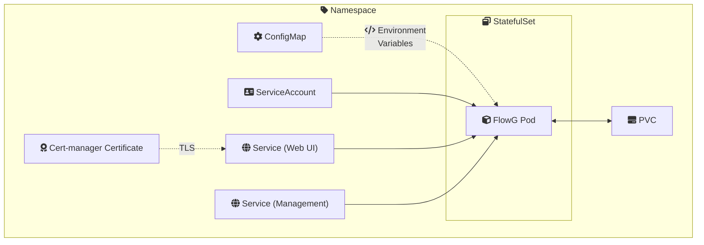
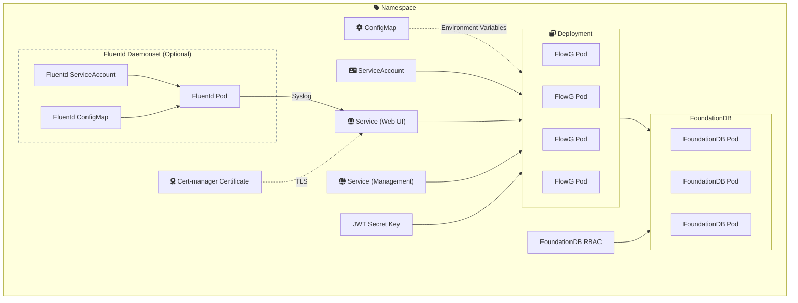

# Deploying using Helm

This guide helps you setup a FlowG Kubernetes cluster using our **Helm charts**. 

This guide splits into 3 different branches, following the needs of your cluster.

1. [Single-node FlowG instance with BadgerDB as a backend](#1-single-node-flowg-instance), if you only need a small installation. 
2. [Multi-node cluster using foundationDB](#2-multi-node-cluster-without-fluentd) (and optionnally an observability stack), if you need multiple instances running 

## Prerequisites 

- A working **Kubernetes cluster** 
- Helm 

## 1. Single-node FlowG instance 

First, clone the repository containing our helm charts:

```bash 
git clone https://github.com/link-society/flowg
cd flowg/k8s/charts
```

> **Configuration**  
> The configuration can be found inside `values.yaml`. The default configuration normally applies to all needs, but you can still customize it if you want. See the [configuration reference](chart_reference.md).


To install the chart, simply run:
```bash
helm install flowg flowg-singlenode -n flowg-system --create-namespace
```

This will create these resources into the chosen namespace:



## 2. Multi-node cluster, with/out Fluentd 

### Installing FoundationDB CRD

In order to make FlowG work with FoundationDB, you first need to intall the [FoundationDB Kubernetes Operator](https://github.com/foundationdb/fdb-kubernetes-operator). 

To do so, a simple way is to use the Helm chart they provide.

```bash
# Clone the repository 
git clone https://github.com/foundationdb/fdb-kubernetes-operator
cd fdb-kubernetes-operator

# Install FoundationDB CRD
# We install it in the same namespace as FlowG 
helm install foundationdb charts/fdb-opeator -n flowg-system --create-namespace
``` 

### Setting up FlowG

The instructions are close to the ones for the other charts. First, you need to clone the repository:
```bash
git clone https://github.com/link-society/flowg
cd flowg
```

> **Configuration**  
> The configuration can be found inside `values.yaml`. The default configuration normally applies to all needs, but you can still customize it if you want. See the [configuration reference](chart_reference.md).

And then install the chart following your needs:

- **If you don't need fluentD**: 
```bash
helm install flowg flowg-multinode -n flowg-system --create-namespace
```

- **If you want an observability stack based on fluentd**: 
```bash
helm install flowg flowg-observability -n flowg-system --create-namespace
``` 

> **Fluentd**  
> Fluentd manages all the log routing to FlowG by gathering ALL the logfiles specified in the `logdir` in `values.yaml`, except fluentd's own logs, and sends it to FlowG's syslog server.  
> The applied configuration is minimal and only parse the entries following the CRI (Kubernetes) format to send it under Json format to FlowG.  


> **Important note**  
> The cluster will take some time to get brought up. This is normal. FoundationDB takes time reconciling their cluster and creating the cluster file. An init container waiting for it will be waiting for it to exist before running FlowG (to avoid it crashing on startup).




